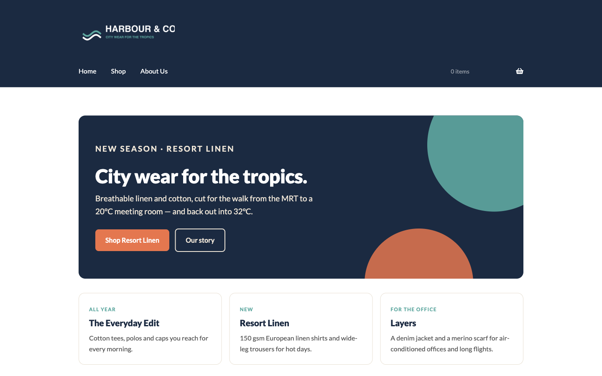
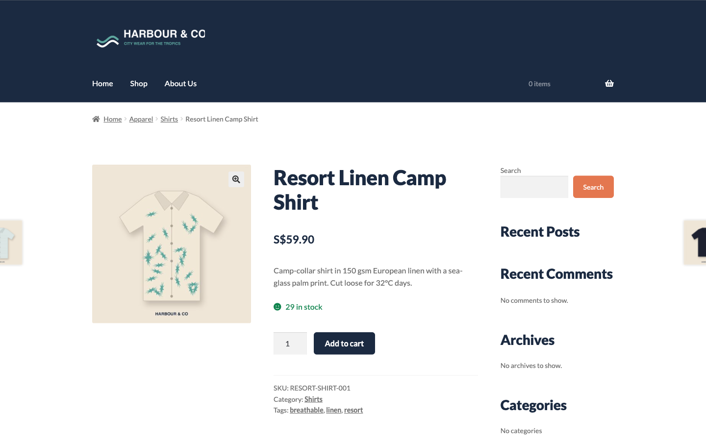
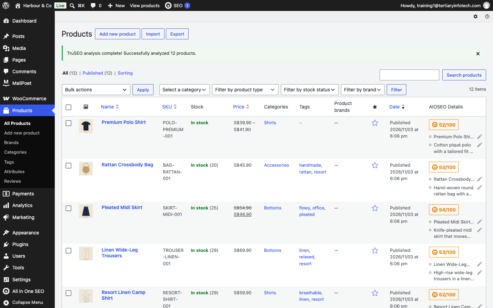
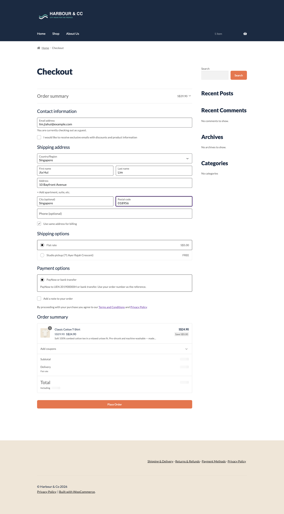
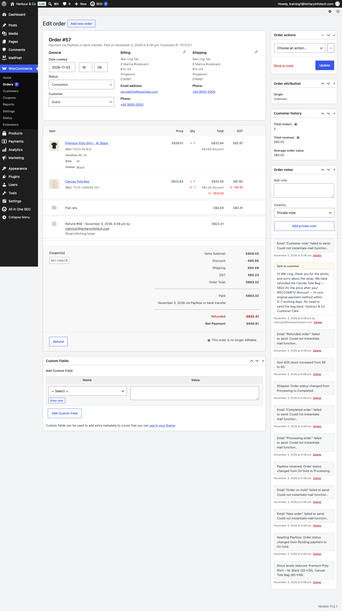
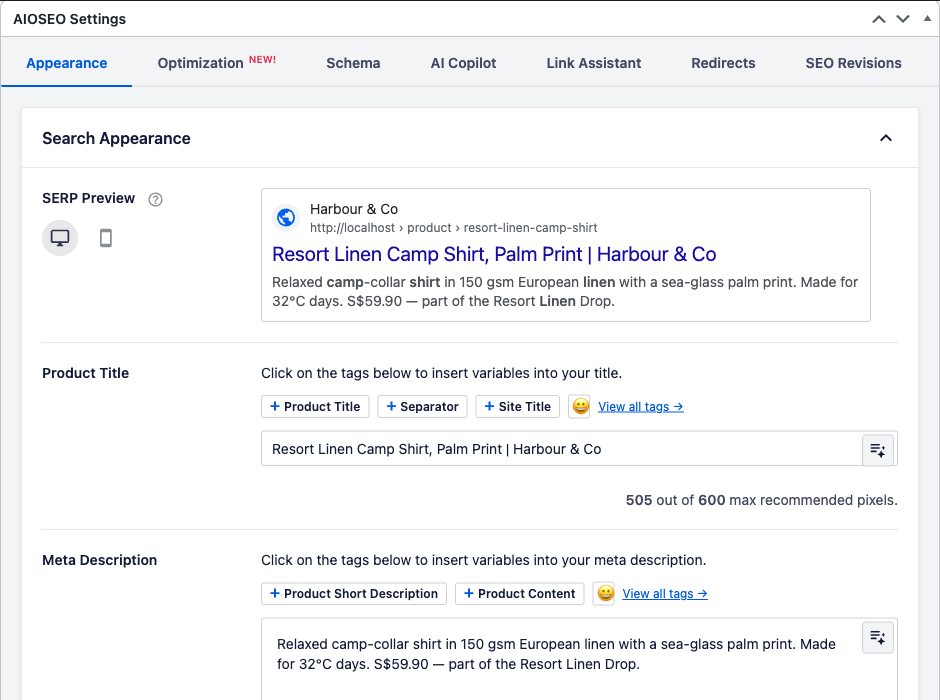
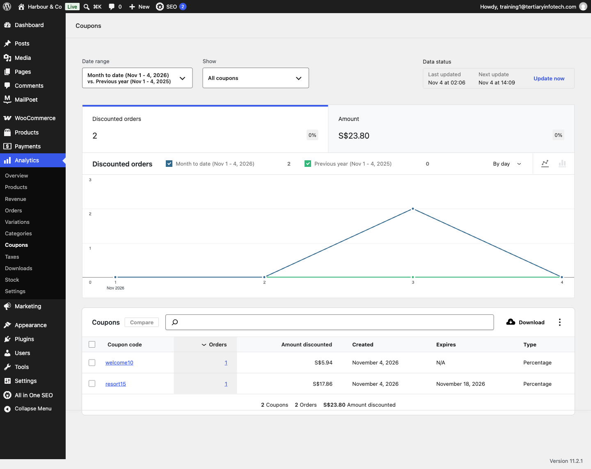

# Build a Professional eCommerce Store with Generative AI — Learner Guide

**Course Code:** C6  |  **Conducted by:** Tertiary Infotech Academy Pte Ltd (UEN 201200696W)  |  **Version v2.0 · 4 November 2026**

## Contents

- [Introduction](#introduction)
- [Course Learning Outcomes](#course-learning-outcomes)
- [Before You Start — Setting Up for the Hands-On Labs](#before-you-start--setting-up-for-the-hands-on-labs)
- [Topic 01 — AI for WordPress and WooCommerce  (LO1 · the AI toolkit used in every lab)](#topic-01--ai-for-wordpress-and-woocommerce--lo1--the-ai-toolkit-used-in-every-lab)
- [Topic 02 — Overview of WooCommerce CMS  (LO1)](#topic-02--overview-of-woocommerce-cms--lo1)
  - [Activity — Discussion — Content Management Policies for Your Store  (15 minutes)](#activity--discussion--content-management-policies-for-your-store--15-minutes)
  - [Key Concepts for Lab 1](#key-concepts-for-lab-1)
  - [Lab 1 — Launch Harbour & Co — WooCommerce Plus an AI-Designed Homepage](#lab-1--launch-harbour--co--woocommerce-plus-an-ai-designed-homepage)
- [Topic 03 — Manage Products on WooCommerce Store  (LO2, LO3)](#topic-03--manage-products-on-woocommerce-store--lo2-lo3)
  - [Key Concepts for Lab 2](#key-concepts-for-lab-2)
  - [Lab 2 — Shoot and Write a Product with AI](#lab-2--shoot-and-write-a-product-with-ai)
  - [Key Concepts for Lab 3](#key-concepts-for-lab-3)
  - [Lab 3 — Let AI Build the New-Season Catalogue](#lab-3--let-ai-build-the-new-season-catalogue)
- [Topic 04 — Manage Payments and Shipping  (LO4)](#topic-04--manage-payments-and-shipping--lo4)
  - [Activity — Discussion — Recommend Payment and Shipping for Customer Experience  (15 minutes)](#activity--discussion--recommend-payment-and-shipping-for-customer-experience--15-minutes)
  - [Key Concepts for Lab 4](#key-concepts-for-lab-4)
  - [Lab 4 — AI Drafts the Policies, You Switch On Payments and Shipping](#lab-4--ai-drafts-the-policies-you-switch-on-payments-and-shipping)
- [Topic 05 — Manage Sales on WooCommerce Store  (LO5)](#topic-05--manage-sales-on-woocommerce-store--lo5)
  - [Key Concepts for Lab 5](#key-concepts-for-lab-5)
  - [Lab 5 — Run a Day of Orders — Refund, Restock, Reply with AI](#lab-5--run-a-day-of-orders--refund-restock-reply-with-ai)
- [Topic 06 — Manage WooCommerce Performance  (LO6)](#topic-06--manage-woocommerce-performance--lo6)
  - [Activity — Discussion — Metrics to Measure Store Performance  (15 minutes)](#activity--discussion--metrics-to-measure-store-performance--15-minutes)
- [Topic 07 — SEO in the Age of AI Search  (LO6)](#topic-07--seo-in-the-age-of-ai-search--lo6)
  - [Key Concepts for Lab 6](#key-concepts-for-lab-6)
  - [Lab 6 — Get Found — AI Writes the SEO, You Approve It](#lab-6--get-found--ai-writes-the-seo-you-approve-it)
  - [Key Concepts for Lab 7](#key-concepts-for-lab-7)
  - [Lab 7 — Launch the Resort Linen Drop — Social, Newsletter, Results](#lab-7--launch-the-resort-linen-drop--social-newsletter-results)
- [Putting It Together — One Store, End to End](#putting-it-together--one-store-end-to-end)
- [Rebuild the Store at Home](#rebuild-the-store-at-home)
- [Glossary](#glossary)


## Introduction

This Learner Guide accompanies the course Build a Professional eCommerce Store with Generative AI (C6), conducted by Tertiary Infotech Academy Pte Ltd. It is a one-day course, 9:30am – 5:30pm, with 7.5 instructional hours.

You will build one online store from an empty WordPress site, with Generative AI as your co-worker: set the store up (Labs 1–5), get it found in search (Lab 6), and market its launch (Lab 7). AI drafts the homepage, product photos and copy, the catalogue CSV, the policies, the SEO and the campaign; you check every fact and approve anything public.

This guide holds the full step-by-step instructions and every prompt. Each lab also has its own folder (labs/lab-NN-…/) with an instructions PDF, COPY-PROMPTS.txt, data, product assets and templates. Keep this guide — it lets you repeat every lab after the class.


## Course Learning Outcomes

On completion of this course, you will be able to:

- LO1: Setup and monitor WooCommerce CMS to ensure adherence to guidelines and policies.
- LO2: Edit and curate product website on WooCommerce CMS.
- LO3: Maintain product web content on WooCommerce CMS.
- LO4: Recommend payment and shipping methods on WooCommerce CMS to improve customer experience.
- LO5: Manage issues related to WooCommerce CMS such as sales, out-of-stock, promotion etc.
- LO6: Manage WooCommerce CMS performance.


## Before You Start — Setting Up for the Hands-On Labs

**Log in to your demo training site**

The trainer assigns each learner one demo WordPress site. Open its /wp-admin page and sign in. The sites are reset before every class, so experiment freely — never use them for a real shop.

| Site | Login page | Username | Password |
|---|---|---|---|
| wp1 | https://wp1.tertiarytraining.com/wp-admin | training1@tertiaryinfotech.com | given by your trainer |
| wp2 | https://wp2.tertiarytraining.com/wp-admin | training2@tertiaryinfotech.com | given by your trainer |
| wp3 | https://wp3.tertiarytraining.com/wp-admin | training3@tertiaryinfotech.com | given by your trainer |
| wp4 | https://wp4.tertiarytraining.com/wp-admin | training4@tertiaryinfotech.com | given by your trainer |
| wp5 | https://wp5.tertiarytraining.com/wp-admin | training5@tertiaryinfotech.com | given by your trainer |

**What else you need**

- A ChatGPT account (https://chatgpt.com). The free tier works; image generation may be slower.
- A laptop with a modern browser, plus a private/incognito window to view the store as a customer.
- The labs/ folder from the LMS or the course repository — one folder per lab.
- The demo hosting meets WooCommerce's requirements (PHP 7.2+, MySQL 5.6+ / MariaDB 10.0+, 128 MB memory, HTTPS). The labs were tested on WordPress 7.1.4, WooCommerce 11.2.1 and Storefront 4.6.2.

**WordPress plugins and themes used in the labs**

| Plugin / theme | Lab | Where to get it |
|---|---|---|
| WooCommerce | 1 | Plugins > Add Plugin > 'WooCommerce' by Automattic |
| Storefront theme | 1 | Appearance > Themes > Add New Theme |
| Harbour & Co Toolkit | 1 | Plugins > Add Plugin > Upload Plugin > labs/lab-01-…/plugin/harbour-co-toolkit.zip |
| All in One SEO | 6 | Plugins > Add Plugin > 'All in One SEO' |
| MailPoet | 7 | Plugins > Add Plugin > 'MailPoet' |

**The store you will build — Harbour & Co**

Harbour & Co is a Singapore fashion label selling breathable city wear — linen shirts, polos, tees, skirts, trousers and accessories — from a studio shop at 71 Ayer Rajah Crescent. The founder, Rachel Lim, wants to sell online before the Resort Linen season launches. You are her eCommerce lead for the day: set the store up with Generative AI, get it found in search, then market the launch.

- Phase 1 · Set up the store with GenAI (Labs 1–5) — WooCommerce, an AI-designed homepage, AI product photos and copy, an AI-built catalogue, AI-drafted policies, and the orders that follow.

- Phase 2 · Get found — SEO with GenAI (Lab 6) — Keyword research, meta titles, meta descriptions and alt text, written by AI and applied in All in One SEO.

- Phase 3 · Get customers — digital marketing with GenAI (Lab 7) — Social posts, a MailPoet newsletter and a tracked campaign coupon — then the numbers that prove it worked.

**The brand brief — attach it to every ChatGPT chat**

```text
HARBOUR & CO — BRAND BRIEF (paste or attach this in every ChatGPT chat)
=====================================================================
Who we are   Harbour & Co is a Singapore fashion label founded in 2019 by Rachel Lim.
             We make breathable city wear for the tropics: clothes that survive a hot
             commute and a cold office on the same day.
Studio shop  71 Ayer Rajah Crescent, #02-18, Singapore 139951 · open Tue–Sun, 11am–7pm
Online store WooCommerce on WordPress (the store you build today)
Email        hello@harbourandco.example

Customers    Singapore professionals aged 25–40. They walk between MRT, office and
             hawker centre in 32°C heat, then sit in 20°C air-conditioning. They buy
             fewer, better pieces and care how a fabric is made.

Collections  The Everyday Edit — cotton tees, polos and caps (all year)
             Resort Linen      — linen shirts, trousers, rattan bag (new season, Nov launch)
             Layers            — denim jacket and merino scarf for cold offices and travel
             Accessories       — tote, belt, cap, crossbody bag

Voice        Warm, crisp, confident. Short sentences. Concrete facts over adjectives
             (fabric weight, fibre, fit, care). No hype words: no "game-changer",
             "elevate", "must-have", "luxurious". British spelling. Prices in S$,
             inclusive of 9% GST.

Look         Harbour Navy #1B2A41 · Sea Glass #5FA8A0 · Sand #EFE6D8 · Coral #E4774F
             Typeface Lato. Photography: soft daylight, sand or linen backgrounds,
             garments flat-laid or on a relaxed model, no harsh studio flash.

Promises     Free delivery above S$100 · flat S$5 islandwide · free pickup at the studio
             14-day returns on unworn items with tags · PayNow, bank transfer, card
Must never   Claim "100% sustainable", "eco-friendly" or medical/cooling benefits we
             cannot prove · name competitors · invent reviews or awards.

```

**Conventions used in every lab**

- Menu paths are written as they appear in the WordPress sidebar, e.g. WooCommerce > Settings > General.
- Shaded boxes hold the exact values to enter. Dark boxes are prompts — paste them into ChatGPT.
- Click Save changes after every settings screen; WooCommerce never saves automatically.
- AI drafts, you approve: check every fact against the brief or spec before it goes on the store.

> **Note:** Every AI answer is a draft. Policies, prices and claims on a real store are your responsibility — the owner signs them off.


## Topic 01 — AI for WordPress and WooCommerce  (LO1 · the AI toolkit used in every lab)

AI tools · Effective prompts · WordPress AI connectors · AI features in the editor

**Key concepts**

- Choosing an AI tool — ChatGPT, Gemini and Claude compared on strengths, ease of use and price.
- Model tiers — From fast and budget to heavy-duty models, for each provider.
- Effective prompts — Role, context, task, constraints, format and examples.
- Prompting in practice — Generate a replacement About Us page in line with E-E-A-T.
- WordPress AI Connectors — Connect Google, Anthropic or OpenAI from Settings > Connectors (WordPress 7.0+).
- AI in the editor — Enable AI features, and know the WooCommerce Classic Editor limits.


## Topic 02 — Overview of WooCommerce CMS  (LO1)

What WooCommerce is · Installing it · Setup wizard · Themes · Widgets & shortcodes · Settings, currency & tax

**Key concepts**

- What WooCommerce is — An open-source, fully customisable eCommerce platform built on WordPress, powering a large share of the world's online stores.
- Six steps to a store — Choose hosting, install WordPress, pick a theme, activate WooCommerce, run the setup wizard, then extend with plugins.
- System requirements — PHP 7.2+, MySQL 5.6+ or MariaDB 10.0+, a 128 MB WordPress memory limit, and HTTPS support.
- Taxonomies and post types — WooCommerce adds its own post types and taxonomies to WordPress to group and structure products.
- Themes and widgets — The theme sets the storefront's look; widgets surface products, filters and categories in widgetised areas.
- Settings, currency and tax — General, Products, Tax, Shipping, Payments and Privacy settings define how the store behaves and prices goods.


### Activity — Discussion — Content Management Policies for Your Store  (15 minutes)

In pairs, consider a store you would run. Decide what content management policies, guidelines and user permissions it needs, and how you would monitor that people actually follow them.

**Discussion prompts**

- Who should be able to publish a product, and who should only be able to draft one?
- Which WordPress/WooCommerce roles map to those responsibilities?
- What product-content guidelines would you set — image size, description length, mandatory fields?
- Who checks AI-written copy before it goes live, and against which brand rules?

**What to produce**

A short policy statement: the roles, the content guidelines, and how adherence is monitored.

> **Note:** Write your answer down — you will apply the same reasoning to your own store in the labs.


### Key Concepts for Lab 1

- WooCommerce turns WordPress into a store: install the plugin, run the setup wizard, then set currency, tax and roles in WooCommerce > Settings.
- Prices are entered inclusive of 9% GST; set Default customer location to the shop base so every visitor sees GST-inclusive prices.
- AI output becomes a WordPress page three ways: a Custom HTML block, block patterns, or pasted Markdown.
- Roles are the permissions policy: an Administrator changes settings; a Shop manager runs products, orders and coupons.


### Lab 1 — Launch Harbour & Co — WooCommerce Plus an AI-Designed Homepage

Phase 1 · 25 minutes · LO1 · folder labs/lab-01-launch-harbour-and-co/

Install WooCommerce, run the wizard, then let ChatGPT design the homepage you publish.

Objective: Set up and monitor a WooCommerce CMS so it follows the store's guidelines, policies and permissions.

**The business scenario**

Rachel Lim has a WordPress site and a studio shop, but no online store. Today you install WooCommerce, set Singapore dollars and 9% GST the way her accountant wants, give her shop manager the right role, and publish a homepage that ChatGPT designs from the Harbour & Co brand brief.

**You will deliver**

- WooCommerce installed and the setup wizard completed for Harbour & Co
- Store address, S$ currency and 9% GST (prices inclusive) saved
- Storefront theme and the Harbour & Co Toolkit plugin active
- An AI-designed homepage published and set as the front page
- A Shop manager user for Daniel Koh — the permissions policy in action

**Who does what**

- AI does — ChatGPT writes the homepage copy and the page layout as WordPress-ready HTML.
- You decide — You choose the layout, check every claim against the brand brief, and decide who may publish.

**Plugins and themes**

- WooCommerce — Plugins > Add Plugin > search 'WooCommerce' (by Automattic)
- Storefront theme — Appearance > Themes > Add New Theme > search 'Storefront'
- Harbour & Co Toolkit — Plugins > Add Plugin > Upload Plugin > plugin/harbour-co-toolkit.zip

**Lab files**

| File | What it is |
|---|---|
| data/brand-brief.txt | The Harbour & Co brand brief — attach it to every ChatGPT chat |
| data/store-setup-sheet.txt | Every value you enter in the wizard and Settings |
| plugin/harbour-co-toolkit.zip | WordPress plugin: brand styles, Harbour & Co block patterns, block editor for products |
| plugin/harbour-co-toolkit/ | The plugin's source code (read it — it is one PHP file and one CSS file) |
| templates/harbour-home.html | Reference homepage (what a good AI answer looks like) — paste into a Custom HTML block |
| templates/harbour-about.html | Reference About Us page |
| assets/images/harbour-co-logo-light.png | Logo for the navy header (Appearance > Customize > Site Identity) |
| assets/images/harbour-co-logo.png | Logo for light backgrounds (emails, documents) |
| assets/images/hero-resort-linen.jpg | Homepage hero image |

**Step by step**

1. Log in to your demo site — Browser

Open your assigned site's /wp-admin page and sign in. Your username is trainingN@tertiaryinfotech.com, where N is your site number. The demo hosting already meets the WooCommerce requirements (PHP 7.2+, MySQL 5.6+ or MariaDB 10.0+, 128 MB memory, HTTPS).

```text
https://wp1.tertiarytraining.com/wp-admin   →   training1@tertiaryinfotech.com   ·   password from your trainer
(use YOUR site number: wp2 → training2@…, wp3 → training3@…)
```

2. Install and activate WooCommerce — Plugins > Add Plugin

Search for WooCommerce. Check the author is Automattic, click Install Now, then Activate.

```text
Plugins > Add Plugin > search: WooCommerce > Install Now > Activate
```

✓ Expected: The 'Welcome to Woo!' setup wizard opens.

3. Run the setup wizard for Harbour & Co — WooCommerce setup wizard

Click Set up my store. Answer 'Which one of these best describes you?' with I'm already selling, then fill in 'Tell us a bit about your store'. On 'Get a boost with our free features' click Skip this step — we add our own plugins.

```text
Store name: Harbour & Co   ·   Industry: Clothing and accessories   ·   Location: Singapore
```

✓ Expected: You land on WooCommerce > Home with a setup task list.

4. Set the address, selling location and currency — WooCommerce > Settings > General

Enter the studio address, sell to Singapore only, set the default customer location to the shop base (otherwise visitors whose location is unknown see prices without GST), tick Enable taxes, and set the currency options. Save changes.

```text
71 Ayer Rajah Crescent · #02-18 · Singapore · 139951
Selling location(s): Sell to specific countries → Singapore
Default customer location: Shop country/region · Enable taxes ✓
Currency: Singapore dollar ($) — SGD · Position: Left · Thousand separator , · Decimal separator . · Decimals: 2
```

✓ Expected: A Tax tab appears beside General.

5. Enter prices inclusive of 9% GST — WooCommerce > Settings > Tax

Choose 'Yes, I will enter prices inclusive of tax' and save. Open Standard rates, click Insert row and add the Singapore GST rate. Every price you type from now on already contains GST.

```text
Country code: SG · Rate %: 9.0000 · Tax name: GST · Priority: 1 · Shipping: ticked
```

6. Apply the Storefront theme — Appearance > Themes > Add New Theme

Search for Storefront, Install, then Activate. Storefront is the official WooCommerce theme.

7. Upload the Harbour & Co Toolkit plugin — Plugins > Add Plugin > Upload Plugin

Choose plugin/harbour-co-toolkit.zip from this lab folder, click Install Now, then Activate Plugin. It adds the brand colours and Lato font, a 'Harbour & Co' block-pattern category, shows SGD prices as S$ (WooCommerce's default symbol is a plain $), and offers an optional block editor for products (Settings > Harbour & Co) so the WordPress AI tools work on product pages.

✓ Expected: Plugins lists 'Harbour & Co Toolkit' as active; prices now read S$.

8. Ask ChatGPT to design the homepage — ChatGPT (chatgpt.com) — a new chat

Attach data/brand-brief.txt (paperclip icon) and paste the prompt. Read the answer before you use it.

```text
ROLE: You are a senior eCommerce web designer who builds WooCommerce storefronts.
CONTEXT: The attached brand brief describes Harbour & Co, a Singapore fashion label. The site runs WordPress with the Storefront theme. The page will go inside ONE WordPress 'Custom HTML' block.
TASK: Write the homepage as a single self-contained HTML snippet with these sections in order:
1. Hero — headline, one-line pitch, two buttons: 'Shop Resort Linen' (/product-category/apparel/) and 'Our story' (/about-us/)
2. Three collection cards — The Everyday Edit, Resort Linen, Layers — one sentence each
3. A trust bar — free delivery above S$100, 14-day returns, PayNow and card, studio pickup
4. A short founder note from Rachel Lim (3 sentences)
CONSTRAINTS: Use only inline CSS in a <style> block scoped to a .hc-home wrapper. Colours #1B2A41, #5FA8A0, #EFE6D8, #E4774F; font Lato. No JavaScript, no external images, no <html>/<head>/<body> tags. Mobile-friendly (stack cards under 700px). Use British spelling. Prices in S$ including 9% GST. Do not invent facts, reviews, awards or sustainability claims.
FORMAT: One HTML code block, then a 3-bullet list of any claim I should double-check.
```

✓ Expected: One HTML code block plus a short list of claims to verify. Compare yours with templates/harbour-home.html.

9. Publish the homepage — Pages > Add Page

Title the page Home. Click + (block inserter), add a Custom HTML block and paste the HTML. Then click + again > Patterns > Harbour & Co and insert 'New arrivals grid' below it — it lists your newest products automatically. In the Page sidebar set Template: Full width. Publish.

```text
Block: Custom HTML (paste AI answer)  +  Pattern: Harbour & Co > New arrivals grid  ·  Template: Full width
```

10. Make it the front page — Settings > Reading

Under 'Your homepage displays' choose A static page and pick Home. Save changes, then view the site.

```text
Your homepage displays: A static page · Homepage: Home · Posts page: — Select —
```

11. Add the logo and the main menu — Appearance > Customize > Site Identity · Appearance > Menus

Upload assets/images/harbour-co-logo-light.png as the Logo (the header is navy) and Publish. Then create a menu called Main menu with Home, Shop and About Us, tick Display location: Primary Menu, and Save Menu — otherwise Storefront lists every page, including Cart and Sample Page.

```text
Main menu → Home · Shop · About Us   ·   Display location: Primary Menu
```

12. Give the shop manager the right role — Users > Add User

Add Daniel Koh with the Shop manager role. A Shop manager can run products, orders and coupons but cannot install plugins or change users — that is your permissions policy.

```text
Username: daniel.koh · Email: daniel.koh@harbourandco.example · Role: Shop manager
```

✓ Expected: Users lists two people: you (Administrator) and Daniel Koh (Shop manager).

**Prompt Playbook — step → prompt → step → prompt**

- Step 1 · YOU · Log in to your demo site
- Step 2 · YOU · Install and activate WooCommerce
- Step 3 · YOU · Run the setup wizard for Harbour & Co
- Step 4 · YOU · Set the address, selling location and currency
- Step 5 · YOU · Enter prices inclusive of 9% GST
- Step 6 · YOU · Apply the Storefront theme
- Step 7 · YOU · Upload the Harbour & Co Toolkit plugin
- Step 8 · AI PROMPT · Ask ChatGPT to design the homepage
- Step 9 · YOU · Publish the homepage
- Step 10 · YOU · Make it the front page
- Step 11 · YOU · Add the logo and the main menu
- Step 12 · YOU · Give the shop manager the right role



*The Harbour & Co homepage after Lab 1 (docker test store).*

**Checkpoint**

Your site's front page shows the Harbour & Co homepage, prices display in S$, and Users lists Daniel Koh as Shop manager.

- ☐ WooCommerce > Settings > General shows the Ayer Rajah address, Singapore dollar and shop-base customer location
- ☐ Tax > Standard rates has SG · 9% · GST, and prices are entered inclusive of tax
- ☐ Storefront and Harbour & Co Toolkit are active
- ☐ The front page is the AI-designed Home page with the New arrivals grid
- ☐ Daniel Koh is a Shop manager, not an Administrator

**Troubleshooting**

| Symptom | Fix |
|---|---|
| The wizard did not open | Go to WooCommerce > Home; the task list carries the same steps. Or open WooCommerce > Settings directly. |
| Prices show without GST (e.g. $42.11 instead of $45.90) | Set WooCommerce > Settings > General > Default customer location to 'Shop country/region'. |
| Upload Plugin says 'The link you followed has expired' | The zip is larger than the upload limit — ask the trainer, or upload via the Activities folder link on the LMS. |
| The HTML shows as text on the page | You pasted into a Paragraph block. Delete it and paste into a Custom HTML block. |
| 'This block contains unexpected or invalid content' | Click Attempt recovery, or insert the pattern again from + > Patterns > Harbour & Co. |

**Stretch challenge**

Ask ChatGPT for an About Us page that meets E-E-A-T (founder byline, first-hand story, real address) and publish it at /about-us/.


## Topic 03 — Manage Products on WooCommerce Store  (LO2, LO3)

Product types · AI product photos & copy · Variations · Categories, tags & attributes · Up-sells · CSV import

**Key concepts**

- Product types — Simple, Grouped, Virtual, Downloadable, External/Affiliate and Variable each model a different kind of offer.
- The Product Data panel — General, Inventory, Shipping, Linked Products and Attributes — where the substance of a product is defined.
- Images and galleries — A featured image plus a gallery, with catalogue visibility controlling where the product appears.
- Categories, tags, attributes — Categories are hierarchical, tags are flat, and attributes drive filtering and product variations.
- Up-sells and cross-sells — Up-sells appear on the product page; cross-sells appear in the cart; related products are automatic.
- CSV import and export — Create or update hundreds of products in one pass, including variations, from a single CSV file.


### Key Concepts for Lab 2

- A simple product carries the title, long and short descriptions, price, SKU, stock, category, tags and images.
- Prompt the photo with composition, background, light and what to leave out (text, logos, people).
- AI copy is a draft: keep only facts the spec sheet proves; delete banned or unprovable claims.
- Alt text describes the image for screen readers and image search.


### Lab 2 — Shoot and Write a Product with AI

Phase 1 · 10 minutes · LO2 · folder labs/lab-02-ai-product-photos-and-copy/

ChatGPT makes the product photo and writes the copy. You publish the Classic Cotton T-Shirt.

Objective: Edit and curate product web content on the WooCommerce CMS.

**The business scenario**

Harbour & Co's best-seller, the Classic Cotton T-Shirt, has no photo and no copy. A photo shoot costs S$800 and takes a week. You have nine minutes and ChatGPT. Generate an on-brand product photo, write the description from the spec sheet, and publish the product.

**You will deliver**

- An AI-generated product photo that follows the brand photography rules
- A short description (under 30 words) and a long description written by AI, checked by you
- The Classic Cotton T-Shirt published: S$29.90, sale S$24.90, SKU, stock 50, category, tags, image, alt text

**Who does what**

- AI does — ChatGPT generates the product photo and drafts the short and long descriptions.
- You decide — You reject any photo or sentence that breaks the brand brief, and you enter the facts (price, SKU, stock) yourself.

**Plugins and themes**

- WooCommerce (from Lab 1) — Already active

**Lab files**

| File | What it is |
|---|---|
| data/brand-brief.txt | Brand voice and photography rules |
| data/product-spec-TSHIRT-CLASSIC-001.txt | The facts AI must use — fabric, fit, care, price |
| templates/product-description-template.html | The long-description structure (hook · fabric & fit · size guide · care) |
| assets/images/TSHIRT-CLASSIC-001.jpg | Starter image — use it if image generation is slow |
| assets/images/CAP-COTTON-001.jpg | Starter image for the stretch challenge |
| assets/descriptions/TSHIRT-CLASSIC-001.txt | Reference copy — compare after you write yours |

**Step by step**

1. Generate the product photo — ChatGPT (chatgpt.com) — a new chat

Attach data/brand-brief.txt and data/product-spec-TSHIRT-CLASSIC-001.txt, then paste the prompt. Download the image you like.

```text
ROLE: You are a fashion product photographer.
CONTEXT: Harbour & Co (brand brief attached) sells the Classic Cotton T-Shirt (spec attached): a white, relaxed-fit 180 gsm combed-cotton tee.
TASK: Create ONE square (1:1) product photo for the online store.
CONSTRAINTS: Flat lay, viewed from directly above, on a warm sand (#EFE6D8) linen background. Soft daylight from the left, gentle shadow, no harsh flash. The tee is neatly folded at the sleeves. No people, no text, no logos, no props except one small sprig of green leaves in a corner.
FORMAT: Generate the image.
```

✓ Expected: A square, on-brand flat-lay photo. If it takes too long, use assets/images/TSHIRT-CLASSIC-001.jpg.

2. Write the descriptions from the facts — Same ChatGPT chat

```text
ROLE: You are Harbour & Co's copywriter.
CONTEXT: Use ONLY the facts in the attached product spec and the voice rules in the brand brief.
TASK: Write (a) a product SHORT description of at most 30 words, and (b) a LONG description that follows this structure: a 2-sentence hook; 'Fabric & fit'; 'Size guide' as a small table S–XL with chest width in cm from the spec; 'Care'.
CONSTRAINTS: Use British spelling. Prices in S$ including 9% GST. Do not invent facts, reviews, awards or sustainability claims. No claims about cooling, sweat or sustainability.
FORMAT: Two headed sections: SHORT DESCRIPTION and LONG DESCRIPTION (Markdown).
```

✓ Expected: Copy that only uses spec facts. Compare with assets/descriptions/TSHIRT-CLASSIC-001.txt.

3. Fact-check before you paste — You

Read every sentence against the spec. Delete adjectives the brief bans and any fact you cannot find in the spec. This check is the content guideline a CMS policy enforces.

```text
✓ fabric 180 gsm combed cotton   ✓ relaxed unisex fit   ✓ pre-shrunk   ✗ 'cooling'   ✗ 'eco-friendly'
```

4. Create the product — Products > Add new product

Enter the title, paste the LONG description into the editor and the SHORT description into 'Product short description'.

```text
Title: Classic Cotton T-Shirt
```

5. Price, SKU and stock — Product data > General / Inventory / Shipping

Leave the type as Simple product. Enter the prices, then the SKU; tick the stock-tracking box and set the quantity. Add weight.

```text
Regular price 29.90 · Sale price 24.90
SKU TSHIRT-CLASSIC-001 · Track stock quantity ✓ · Quantity 50
Weight 0.2 kg · Dimensions 30 × 20 × 2 cm
```

6. Category and tags — Product categories / Product tags (right sidebar)

Add the category Apparel, then a child category Shirts under it, and tick Shirts. Add three tags.

```text
Category: Apparel > Shirts   ·   Tags: cotton, unisex, casual
```

7. Product image and alt text — Product image > Set product image

Upload your AI photo. In the Media panel fill Alternative Text with a plain description a screen reader can read — this also feeds image search in Lab 6.

```text
Alt text: White Harbour & Co classic cotton t-shirt laid flat on a sand background
```

8. Publish and view it as a customer — Publish > View product

Publish, then open the product in a private window. Check photo, price, short description, tabs, category and tags.

✓ Expected: S$29.90 struck through, S$24.90 sale price, your photo and copy, Apparel > Shirts in the breadcrumb.

**Prompt Playbook — step → prompt → step → prompt**

- Step 1 · AI PROMPT · Generate the product photo
- Step 2 · AI PROMPT · Write the descriptions from the facts
- Step 3 · YOU · Fact-check before you paste
- Step 4 · YOU · Create the product
- Step 5 · YOU · Price, SKU and stock
- Step 6 · YOU · Category and tags
- Step 7 · YOU · Product image and alt text
- Step 8 · YOU · Publish and view it as a customer



*A finished product page after Lab 2.*

**Checkpoint**

The product page shows your AI photo, the short description beside it, S$24.90 sale price and the Apparel > Shirts category.

- ☐ The product photo is AI-generated (or the starter image) and follows the brand photo rules
- ☐ Short description ≤ 30 words; long description uses only spec facts
- ☐ Regular S$29.90, sale S$24.90, SKU TSHIRT-CLASSIC-001, stock 50
- ☐ Category Apparel > Shirts and tags cotton, unisex, casual
- ☐ Alt text filled on the product image

**Troubleshooting**

| Symptom | Fix |
|---|---|
| ChatGPT refuses or is slow to make images | Use the starter image in assets/images/ and continue — the copy step does not depend on it. |
| The image has text or a logo on it | Reply: 'Regenerate with no text, no logos, nothing printed on the shirt.' |
| The sale price does not show | Check the sale price is lower than the regular price and that no sale schedule dates are set in the future. |

**Stretch challenge**

Repeat for the Cotton Cap (CAP-COTTON-001, S$19.90, Accessories) and ask ChatGPT for three photo variations — pick the one that best matches the brief.


### Key Concepts for Lab 3

- Variable products carry attributes used for variations; every variation needs its own price.
- Categories are hierarchical (Apparel > Shirts); tags are flat; up-sells show on the product page, cross-sells in the cart.
- The CSV importer needs exact headers; for a first import leave 'Update existing products' unticked — it skips new SKUs.
- AI can turn messy notes into a CSV, but you check every SKU, price and stock figure before importing.


### Lab 3 — Let AI Build the New-Season Catalogue

Phase 1 · 10 minutes · LO3 · folder labs/lab-03-ai-builds-the-catalogue/

Rachel's WhatsApp notes become a WooCommerce CSV. Import it, add the polo's six variations, link the up-sells.

Objective: Ensure smooth maintenance and consistent bulk updates of the product catalogue.

**The business scenario**

The Resort Linen pieces arrive next week. Rachel's product details are scattered WhatsApp messages. Typing four products by hand invites typos in SKUs and prices. ChatGPT turns her notes into an import-ready CSV; you import it with the core range, build the Premium Polo's size and colour variations, and link up-sells so customers see the next-best item.

**You will deliver**

- harbour-co-new-season.csv generated by AI from the supplier notes and checked by you
- Nine products imported by CSV into Apparel > Shirts, Apparel > Bottoms, Apparel > Outerwear and Accessories
- The Premium Polo Shirt as a variable product: 3 sizes × 2 colours = 6 priced, stocked variations
- Up-sell and cross-sell links on the Classic Cotton T-Shirt

**Who does what**

- AI does — ChatGPT converts messy notes into a CSV with WooCommerce's exact column headers.
- You decide — You check SKUs, prices and stock against the notes before importing — the importer will not.

**Plugins and themes**

- WooCommerce product CSV importer — Built in — Products > All Products > Import

**Lab files**

| File | What it is |
|---|---|
| data/brand-brief.txt | Brand brief |
| data/supplier-notes.txt | Rachel's WhatsApp notes for the four new-season products |
| data/harbour-co-products.csv | Core range — five products, ready to import |
| data/harbour-co-new-season-reference.csv | Reference answer — import this if your AI CSV fails |
| data/polo-variations.csv | The six polo variations: size, colour, SKU, price |
| assets/images/ | Starter images for every catalogue product |
| assets/descriptions/ | Reference copy for every catalogue product |

**Step by step**

1. Turn the supplier notes into a CSV — ChatGPT (chatgpt.com) — a new chat

Attach data/supplier-notes.txt and data/brand-brief.txt, then paste the prompt.

```text
ROLE: You are an eCommerce catalogue manager who prepares WooCommerce imports.
CONTEXT: The attached supplier notes list four new Harbour & Co products. The brand brief sets the voice.
TASK: Produce a CSV for the WooCommerce product importer, one row per product.
CONSTRAINTS: Use exactly these headers in this order: Type,SKU,Name,Published,Short description,Regular price,Sale price,Categories,Tags,In stock?,Stock,Weight (kg)
Type = simple. Published = 1. In stock? = 1. Categories use ' > ' for hierarchy, e.g. Apparel > Bottoms. Weight in kg (250g = 0.25). Prices are numbers with no S$ sign. Leave Sale price empty when there is no promo. Short description ≤ 25 words in the brand voice, built only from the notes. Wrap any field containing a comma in double quotes. Tag every linen or resort item with 'resort'.
FORMAT: One CSV code block only, then a table listing each SKU with its price and stock so I can check them.
```

✓ Expected: Four rows. Save the code block as harbour-co-new-season.csv (UTF-8).

2. Check the CSV against the notes — You (a spreadsheet or text editor)

Compare each SKU, price, sale price, stock and category with the notes. Fix mistakes in the file, not in ChatGPT.

```text
RESORT-SHIRT-001 59.90 · 30
TROUSER-LINEN-001 69.90 · 30 · Apparel > Bottoms
SKIRT-MIDI-001 54.90 / sale 46.90 · 25
BAG-RATTAN-001 45.90 · 20 · Accessories
```

3. Import the core range — Products > All Products > Import

Choose data/harbour-co-products.csv, click Continue, review the column mapping, then Run the importer.

✓ Expected: 'Import complete! 5 products imported.'

4. Import your AI-generated CSV — Products > All Products > Import

Repeat with harbour-co-new-season.csv. If the importer rejects it, import data/harbour-co-new-season-reference.csv instead and compare the two files to see why.

✓ Expected: 4 products imported; Apparel > Bottoms is created automatically.

5. Create the variable polo — Products > Add new product

Title Premium Polo Shirt. In Product data change Simple product to Variable product.

```text
Title: Premium Polo Shirt   ·   Product data: Variable product   ·   Category: Apparel > Shirts
```

6. Add Size and Colour attributes — Product data > Attributes

Add a custom attribute Size, then Colour. Tick 'Used for variations' on both and Save attributes.

```text
Size:  S | M | L
Colour:  Black | White
```

7. Generate and price the six variations — Product data > Variations

Click Generate variations. Expand each one and enter its SKU, price and stock (see data/polo-variations.csv). Set the default form values to M / Black. Publish.

```text
POLO-S-BLK 39.90 · POLO-M-BLK 39.90 · POLO-L-BLK 41.90
POLO-S-WHT 39.90 · POLO-M-WHT 39.90 · POLO-L-WHT 41.90   ·   Stock 25 each
```

✓ Expected: The product page shows S$39.90 – S$41.90 and Size / Colour dropdowns.

8. Link up-sells and cross-sells — Classic Cotton T-Shirt > Product data > Linked Products

Up-sell the more premium polo on the product page; cross-sell the cap and tote in the cart. Update.

```text
Upsells: Premium Polo Shirt   ·   Cross-sells: Cotton Cap, Canvas Tote Bag
```

9. Ask AI for a catalogue audit — Same ChatGPT chat

Export the catalogue (Products > All Products > Export > Generate CSV), attach the file and paste the prompt.

```text
ROLE: You are a catalogue QA analyst.
CONTEXT: The attached file is Harbour & Co's full product export.
TASK: Find maintenance problems: missing images, missing short descriptions, duplicate or malformed SKUs, products with no category or still in 'Uncategorized', sale prices higher than regular prices, stock of 0.
FORMAT: A table: SKU · problem · fix. Then the three fixes that matter most for customers.
```

✓ Expected: A short fix list — most rows will say 'no image' until you add the starter images.

**Prompt Playbook — step → prompt → step → prompt**

- Step 1 · AI PROMPT · Turn the supplier notes into a CSV
- Step 2 · YOU · Check the CSV against the notes
- Step 3 · YOU · Import the core range
- Step 4 · YOU · Import your AI-generated CSV
- Step 5 · YOU · Create the variable polo
- Step 6 · YOU · Add Size and Colour attributes
- Step 7 · YOU · Generate and price the six variations
- Step 8 · YOU · Link up-sells and cross-sells
- Step 9 · AI PROMPT · Ask AI for a catalogue audit



*Products > All Products after Lab 3: imported products, the polo's price range, the category hierarchy.*

**Checkpoint**

All Products lists 11 products, the polo shows S$39.90 – S$41.90, and Apparel has Shirts, Bottoms and Outerwear under it.

- ☐ Nine CSV-imported products plus the T-shirt and polo appear in All Products
- ☐ Categories: Apparel > Shirts, Apparel > Bottoms, Apparel > Outerwear and Accessories
- ☐ The polo has six variations, each with SKU, price and stock
- ☐ The T-shirt up-sells the polo and cross-sells the cap and tote

**Troubleshooting**

| Symptom | Fix |
|---|---|
| Importer: 'Invalid file type' | Save as .csv (UTF-8). In Excel use 'CSV UTF-8 (Comma delimited)'. |
| Columns land in the wrong fields | On the mapping screen choose the right WooCommerce field for each column, or fix the header spelling. |
| 'Import complete' but 0 products imported | You ticked 'Update existing products'. That option only updates SKUs already in the store and skips new ones — untick it for a first import. |
| A variation is missing from the dropdown | Every variation needs its own price. Expand it and enter the Regular price. |
| Cotton Cap is not in the cross-sell search | Create it first (Lab 2 challenge) or pick another accessory. |

**Stretch challenge**

Add the starter images to the nine imported products and ask ChatGPT to write a 2-line category description for Apparel > Bottoms.


## Topic 04 — Manage Payments and Shipping  (LO4)

Store policies · Online & offline payment methods · Gateways · Shipping zones · Flat rate, free shipping & local pickup

**Key concepts**

- Payment methods — Online gateways such as Stripe and PayPal, plus offline options like bank transfer, cheque and cash on delivery.
- Choosing a gateway — Location, fees, supported currencies and whether the customer stays on your site all shape the decision.
- Shipping zones — A zone is a geographic region; each zone carries its own shipping methods and rates.
- Flat rate shipping — A standard cost per order, per item or per shipping class, defined inside a shipping zone.
- Free shipping — A powerful incentive — commonly gated behind a minimum order amount or a valid coupon.
- Store policies — Privacy (PDPA), returns, shipping and payment pages tell customers what to expect before they pay.


### Activity — Discussion — Recommend Payment and Shipping for Customer Experience  (15 minutes)

Working from the store you have built, recommend the payment and shipping mix that would give your customers the best experience — and justify the trade-offs.

**Discussion prompts**

- Which payment methods do your customers expect, and what does each one cost you?
- Does the customer stay on your site, or get redirected? Why does that matter for conversion?
- Would free shipping above a threshold raise your average order value or erode your margin?
- Which shipping zones do you actually serve, and what happens to orders outside them?

**What to produce**

A recommended payment and shipping configuration with the customer-experience reason for each choice.

> **Note:** Write your answer down — you will apply the same reasoning to your own store in the labs.


### Key Concepts for Lab 4

- Customers read four pages before paying: Privacy (PDPA), Returns & Refunds, Shipping & Delivery, Payment Methods.
- Offline payments (PayNow / bank transfer, pay at pickup) hold the order until payment is confirmed.
- A shipping zone holds methods: flat rate, free shipping above a minimum, local pickup.
- Shipping costs are entered excluding tax — enter 4.59 (taxable) to charge S$5.00.


### Lab 4 — AI Drafts the Policies, You Switch On Payments and Shipping

Phase 1 · 25 minutes · LO4 · folder labs/lab-04-ai-policies-payments-shipping/

ChatGPT drafts the privacy, returns, shipping and payment pages. You make the checkout keep every promise.

Objective: Recommend and configure payment and shipping methods that improve customer experience.

**The business scenario**

Customers will not pay a store that hides its rules. Harbour & Co needs four pages before launch — Privacy Policy (Singapore PDPA), Returns & Refunds, Shipping & Delivery and Payment Methods — and a checkout that matches them: PayNow or bank transfer, pay at pickup, S$5 delivery, free above S$100, free studio pickup.

**You will deliver**

- Four AI-drafted policy pages, checked against the brand promises and published
- Privacy and Terms pages linked in Settings so checkout shows them
- Payments: Direct bank transfer (PayNow) and Pay at pickup enabled
- Shipping zone Singapore: flat rate S$5, free shipping from S$100, local pickup
- A 'Customer care' footer menu linking the four policies

**Who does what**

- AI does — ChatGPT drafts every policy page from the brand promises in the brief.
- You decide — You check every promise matches the settings you configure — and you flag the drafts for the owner's legal review.

**Plugins and themes**

- WooCommerce (from Lab 1) — Offline payment methods are built in

**Lab files**

| File | What it is |
|---|---|
| data/brand-brief.txt | Brand promises: delivery, returns, payment |
| data/policy-facts.txt | The facts every policy must state: fees, days, contact, PDPA officer |
| templates/privacy-policy.html | Reference draft — Privacy Policy (PDPA) |
| templates/returns-and-refunds.html | Reference draft — Returns & Refunds |
| templates/shipping-and-delivery.html | Reference draft — Shipping & Delivery |
| templates/payment-methods.html | Reference draft — Payment Methods |
| templates/terms-and-conditions.html | Reference draft — Terms and Conditions |

**Step by step**

1. Draft the four policy pages — ChatGPT (chatgpt.com) — a new chat

Attach data/brand-brief.txt and data/policy-facts.txt, then paste the prompt.

```text
ROLE: You are an eCommerce operations writer for small Singapore retailers.
CONTEXT: Harbour & Co (brief attached). The attached policy facts are the ONLY source of fees, days and contacts.
TASK: Draft four customer-facing pages: 1) Privacy Policy aligned to Singapore's Personal Data Protection Act 2012 (PDPA) — what we collect at checkout, why, who we share it with (payment and delivery partners), retention, the customer's access and correction rights, our Data Protection Officer contact; 2) Returns & Refunds; 3) Shipping & Delivery; 4) Payment Methods.
CONSTRAINTS: Plain English, short headed sections, under 350 words per page. Use only the facts given — if a fact is missing write [TO CONFIRM]. Use British spelling. Prices in S$ including 9% GST. Do not invent facts, reviews, awards or sustainability claims.
FORMAT: Four Markdown sections, each starting with the page title as a # heading.
```

✓ Expected: Four pages. Any [TO CONFIRM] marks a fact Rachel must supply.

2. Check every promise — You

Tick each number against policy-facts.txt. The page and the checkout must say the same thing.

```text
Delivery S$5 islandwide · free from S$100 · 2–4 working days
Returns 14 days · unworn with tags · refund in 5–7 working days
Pickup free at 71 Ayer Rajah Crescent, Tue–Sun 11am–7pm
```

3. Publish the four pages — Pages > Add Page

Create Privacy Policy, Returns & Refunds, Shipping & Delivery and Payment Methods. Paste the Markdown — the block editor turns # headings and lists into blocks. Publish each.

```text
WordPress already has a draft 'Privacy Policy' page — open it from Pages and replace its content.
```

4. Link privacy and terms to checkout — Settings > Privacy · WooCommerce > Settings > Advanced

In Settings > Privacy select your Privacy Policy page. In WooCommerce > Settings > Advanced > Page setup set Terms and conditions to Returns & Refunds (or a Terms page from the challenge). Save.

✓ Expected: Checkout now shows the privacy notice and a terms checkbox.

5. Switch on PayNow / bank transfer — WooCommerce > Settings > Payments > Take offline payments

Enable Direct bank transfer, then Manage it and rename it so customers recognise it. Add the account details.

```text
Title: PayNow or bank transfer
Instructions: PayNow to UEN 201900000H (Harbour & Co Pte Ltd). Use your order number as the reference.
Account: Harbour & Co Pte Ltd · DBS · 000-000000-0 (training data)
```

6. Switch on pay at pickup — WooCommerce > Settings > Payments > Take offline payments

Enable Cash on delivery, rename it, and limit it to local pickup so nobody expects a courier to collect cash.

```text
Title: Pay at pickup (cash or card)   ·   Enable for shipping methods: Local pickup
```

7. Build the Singapore shipping zone — WooCommerce > Settings > Shipping > Add zone

Name the zone, choose the region, then add three shipping methods and set each one.

```text
Zone name: Singapore · Zone regions: Singapore
1) Flat rate — Tax status: Taxable · Cost 4.59  (shipping costs are entered EXCLUDING GST: 4.59 + 9% = S$5.00)
2) Free shipping — Free shipping requires: A minimum order amount · 100.00
3) Local pickup — Name: Studio pickup (71 Ayer Rajah Crescent) · Cost: blank (free)
```

8. Add the Customer care footer menu — Appearance > Menus

Create a menu called Customer care with the four policy pages. Then Appearance > Widgets > Footer Column 2 > + > Navigation Menu > Customer care. Update.

```text
Menu: Customer care → Shipping & Delivery · Returns & Refunds · Payment Methods · Privacy Policy
```

9. Test the checkout as a customer — Private browser window

Add the T-shirt to the cart, go to Checkout, enter a Singapore address (fill City: Singapore — checkout rejects a blank city) and look — do not place the order yet.

✓ Expected: Flat rate S$5.00, Local pickup, and (once the cart passes S$100) Free shipping; PayNow or bank transfer; Pay at pickup; policy links.

**Prompt Playbook — step → prompt → step → prompt**

- Step 1 · AI PROMPT · Draft the four policy pages
- Step 2 · YOU · Check every promise
- Step 3 · YOU · Publish the four pages
- Step 4 · YOU · Link privacy and terms to checkout
- Step 5 · YOU · Switch on PayNow / bank transfer
- Step 6 · YOU · Switch on pay at pickup
- Step 7 · YOU · Build the Singapore shipping zone
- Step 8 · YOU · Add the Customer care footer menu
- Step 9 · YOU · Test the checkout as a customer



*Checkout after Lab 4: delivery options, PayNow / bank transfer and the privacy / terms notice.*

**Checkpoint**

Checkout shows three delivery options, two payment methods, and links to the Privacy Policy and Terms.

- ☐ Four policy pages are published and in the Customer care footer menu
- ☐ Privacy page is set in Settings > Privacy; a Terms page is set in WooCommerce > Advanced
- ☐ Two payment methods are enabled with customer-friendly titles
- ☐ The Singapore zone has flat rate S$5, free shipping from S$100 and local pickup
- ☐ The checkout options match what the policy pages promise

**Troubleshooting**

| Symptom | Fix |
|---|---|
| No shipping options at checkout | The address must be in Singapore (inside the zone) and each method must be enabled in the zone. |
| Free shipping never appears | The cart total must reach S$100 after any coupon; check 'Requires: A minimum order amount'. |
| Pay at pickup shows for delivery orders | Set 'Enable for shipping methods' to Local pickup only. |
| Flat rate shows S$5.45, not S$5.00 | Shipping costs are entered excluding tax. Enter 4.59 with Tax status Taxable, or 5.00 with Tax status None. |

**Stretch challenge**

Ask ChatGPT for Terms and Conditions using the same facts, publish it, and point WooCommerce > Advanced > Terms and conditions at it.


## Topic 05 — Manage Sales on WooCommerce Store  (LO5)

Orders & order statuses · Editing single orders · Refunds & restocking · Coupons and promotions

**Key concepts**

- Orders and statuses — Pending, Processing, Completed, On-Hold, Cancelled, Refunded and Failed track an order's life.
- Managing orders — View, filter and edit orders; change status, edit line items, add fees and apply coupons.
- Adding orders manually — Phone and offline sales can be entered by hand and emailed to the customer for payment.
- Refunds — Refund manually or through the gateway, with the option to restock the returned items.
- Stock issues — Stock management, low-stock thresholds and out-of-stock handling prevent overselling.
- Coupons and promotions — Percentage, fixed cart and fixed product discounts, with usage limits and expiry dates.


### Key Concepts for Lab 5

- Order statuses: Pending payment → On hold (bank transfer) → Processing → Completed; Refunded, Cancelled, Failed.
- Refunds can restock items so inventory stays accurate.
- Coupons: percentage, fixed cart or fixed product, with minimum spend, usage limits and expiry.
- A Note to customer on the order emails the reply and keeps it on the record.


### Lab 5 — Run a Day of Orders — Refund, Restock, Reply with AI

Phase 1 · 25 minutes · LO5 · folder labs/lab-05-orders-refunds-ai-replies/

Take an order with WELCOME10, refund a damaged item with restocking, and send a reply ChatGPT drafted.

Objective: Highlight and resolve issues related to sales, stock, refunds and promotions.

**The business scenario**

Launch morning. Tan Wei Ling orders a polo and a tote using the welcome coupon, then emails: the tote's strap stitching came loose. Daniel is off sick, so you run the shop: process the order, refund the tote and put it back in stock, and send her a reply that sounds like Harbour & Co — drafted by AI, approved by you.

**You will deliver**

- WELCOME10 coupon: 10% off, minimum spend S$50, one use per customer
- A test order placed at checkout with WELCOME10 and moved from Processing to Completed
- The tote refunded with 'Restock refunded items' ticked
- An AI-drafted, human-approved note to the customer on the order
- A manual phone order created for a walk-in customer

**Who does what**

- AI does — ChatGPT drafts the customer reply and an out-of-stock message.
- You decide — You decide the refund, check the amount, edit the reply and press send.

**Plugins and themes**

- WooCommerce (from Lab 1) — Orders, coupons and refunds are built in

**Lab files**

| File | What it is |
|---|---|
| data/brand-brief.txt | Voice for customer replies |
| data/customer-tan-wei-ling.txt | The mock customer, her order and her complaint email |
| data/order-issues.csv | Five realistic order issues to triage |
| templates/customer-replies.txt | Reference replies: refund, out of stock, delayed delivery |

**Step by step**

1. Create the WELCOME10 coupon — Marketing > Coupons > Add coupon

Enter the code and set the rules on each tab. Publish.

```text
Code: WELCOME10 · Discount type: Percentage discount · Amount: 10
Usage restriction: Minimum spend 50
Usage limits: Usage limit per user 1
```

2. Place the test order — Private browser window (as the customer)

Add a Premium Polo (M / Black) and a Canvas Tote Bag. At checkout apply WELCOME10, use Tan Wei Ling's details and pay with PayNow or bank transfer.

```text
Tan Wei Ling · tan.weiling@example.com · 8 Marina Boulevard, #12-04 · City: Singapore · Postcode 018981
```

✓ Expected: Subtotal S$64.80 · WELCOME10 −S$6.49 · Flat rate S$5.00 · Total S$63.32 (includes GST) · order status On hold.

3. Move the order through its statuses — WooCommerce > Orders > the order

Bank transfer orders arrive On hold. Mark it Processing when the PayNow money lands, then Completed once shipped. Update each time.

```text
On hold → Processing (payment received) → Completed (shipped)
```

4. Draft the reply with AI — ChatGPT (chatgpt.com) — a new chat

Attach data/brand-brief.txt and data/customer-tan-wei-ling.txt, then paste the prompt.

```text
ROLE: You are Harbour & Co's customer-care lead.
CONTEXT: Tan Wei Ling's email and order are attached. We will refund the Canvas Tote Bag in full to her original payment method within 5–7 working days and she does not need to post it back.
TASK: Draft a reply to her.
CONSTRAINTS: Under 120 words. Apologise once, state the refund amount (S$24.90 less her share of the 10% coupon = S$22.41) and timing, thank her for the photo, no discount bribes, sign off as Harbour & Co Customer Care. Use British spelling. Prices in S$ including 9% GST. Do not invent facts, reviews, awards or sustainability claims.
FORMAT: Plain text, ready to paste.
```

✓ Expected: A short, warm reply with the exact refund figure. Edit anything that over-promises.

5. Refund the tote and restock it — WooCommerce > Orders > the order > Refund

Enter quantity 1 against the Canvas Tote Bag, tick 'Restock refunded items', give the reason, and click Refund manually.

```text
Refund quantity: 1 × Canvas Tote Bag · Restock refunded items ✓ · Reason: strap stitching loose
```

✓ Expected: A red refund line, and an order note 'Item #… stock increased from 59 to 60'.

6. Send your approved reply — Order notes (right sidebar)

Paste your edited reply, choose Note to customer, and click Add. WooCommerce emails it and keeps it on the order record.

```text
Add note → Note to customer → Add
```

7. Enter a phone order by hand — WooCommerce > Orders > Add order

A walk-in customer phoned: one Linen Summer Shirt for local pickup. Add the customer, the product and the Local pickup shipping line, then Create.

✓ Expected: A new Pending payment order you can email to the customer for payment.

8. Triage the rest of the inbox with AI — Same ChatGPT chat

Attach data/order-issues.csv and paste the prompt.

```text
ROLE: You are a WooCommerce store manager.
CONTEXT: The attached CSV lists five customer issues.
TASK: For each, give the order status to set, the WooCommerce action (refund, restock, edit order, coupon, note) and a one-line customer reply.
FORMAT: A table: issue · status · action · reply.
```

✓ Expected: A triage table you can act on — check each action is possible in WooCommerce.

**Prompt Playbook — step → prompt → step → prompt**

- Step 1 · YOU · Create the WELCOME10 coupon
- Step 2 · YOU · Place the test order
- Step 3 · YOU · Move the order through its statuses
- Step 4 · AI PROMPT · Draft the reply with AI
- Step 5 · YOU · Refund the tote and restock it
- Step 6 · YOU · Send your approved reply
- Step 7 · YOU · Enter a phone order by hand
- Step 8 · AI PROMPT · Triage the rest of the inbox with AI



*The order screen after Lab 5: coupon, restocked refund and the note to the customer.*

**Checkpoint**

The order shows WELCOME10, a refund for the tote, a stock-increase order note, and your note to the customer.

- ☐ WELCOME10 exists with minimum spend S$50 and one use per customer
- ☐ The test order used WELCOME10 and reached Completed
- ☐ The tote is refunded and its stock went back up
- ☐ The order carries your note to the customer
- ☐ A manual order exists for the phone customer

**Troubleshooting**

| Symptom | Fix |
|---|---|
| 'The minimum spend for this coupon is S$50.00' | The cart must reach S$50 before the discount — add the tote. |
| Refund button is missing | Refunds are available once the order is Processing or Completed. |
| Stock did not go back up | 'Restock refunded items' was not ticked — adjust stock in the product's Inventory tab. |

**Stretch challenge**

Ask ChatGPT for a polite 'back in stock soon' message, then set the Classic Denim Jacket stock to 0 and check how the product page reports it.


## Topic 06 — Manage WooCommerce Performance  (LO6)

Reports & Analytics · Customer & stock reports · Dashboard widgets · eCommerce metrics · Google Analytics

**Key concepts**

- WooCommerce Reports — Orders, Customers, Stock and Taxes — the built-in view of how the store is performing.
- Sales reports — Gross and net sales by date, product and category, plus top sellers, top earners and coupon usage.
- Customer and stock reports — Customers versus guests, and low-stock, out-of-stock and on-backorder items.
- Dashboard widgets — At-a-glance store status on the WordPress dashboard, configurable through Screen Options.
- eCommerce metrics — Conversion rate, traffic, revenue by source, retention, repeat purchase and refund rate.
- Google Analytics — Integrating analytics attributes revenue to channels and shows where customers drop off.


### Activity — Discussion — Metrics to Measure Store Performance  (15 minutes)

Decide which metrics you would use to judge whether the store is succeeding, and what criteria make a metric worth tracking at all.

**Discussion prompts**

- Which three metrics would you put in front of the business owner every week?
- What makes a metric useful — is it actionable, comparable, and tied to a decision?
- What does a rising refund rate or a falling repeat-customer rate actually tell you?
- Which report or tool produces each metric — WooCommerce Analytics or Google Analytics?

**What to produce**

A shortlist of performance metrics with the criteria used to select them and their data source.

> **Note:** Write your answer down — you will apply the same reasoning to your own store in the labs.


## Topic 07 — SEO in the Age of AI Search  (LO6)

How search works · SEO, AEO & GEO · E-E-A-T · AI for SEO · On-page SEO · Digital marketing with GenAI

**Key concepts**

- How search works — Crawl, index, rank and serve — and what a modern results page looks like.
- SEO, AEO and GEO — Rich snippets, featured snippets and AI Overviews, and how the three disciplines connect.
- E-E-A-T — Experience, Expertise, Authoritativeness and Trustworthiness.
- AI tools for SEO — Write prompts around objective, keywords, intent, structure and on-page needs.
- Titles, descriptions and URLs — The on-page elements that shape how a page appears in search.
- Campaigns that measure themselves — Social posts and newsletters carry a coupon and UTM tags, so Analytics shows which channel sold.


### Key Concepts for Lab 6

- One primary keyword per page; meta title ≈ 60 characters (AIOSEO: 600 pixels), meta description ≈ 155.
- AI cannot see live search volumes — treat its estimates as guesses and decide yourself.
- Alt text and an XML sitemap help crawlers find and understand the store.


### Lab 6 — Get Found — AI Writes the SEO, You Approve It

Phase 2 · 10 minutes · LO6 · folder labs/lab-06-ai-seo/

Keywords from ChatGPT, meta titles under 60 characters, descriptions under 155, alt text on every image.

Objective: Maintain web content that search engines and AI answers can find, and set the search metrics you will track.

**The business scenario**

The store works, but nobody can find it. 'Linen shirt singapore' should land on Harbour & Co, not a marketplace. You ask ChatGPT for buyer keywords, map one keyword to each page, write meta titles and descriptions in All in One SEO, fill the alt text, and check the sitemap Google will crawl.

**You will deliver**

- A keyword map: one primary keyword per page, from AI research checked by you
- Meta title (≤ 60 characters) and meta description (≤ 155 characters) on the home page and three products
- Alt text on every product image
- The XML sitemap live at /sitemap.xml

**Who does what**

- AI does — ChatGPT researches buyer keywords and writes titles, descriptions and alt text to the character limits.
- You decide — You choose the keyword for each page and approve the wording — AI cannot see your rankings.

**Plugins and themes**

- All in One SEO (AIOSEO) — Plugins > Add Plugin > search 'All in One SEO' > Install Now > Activate

**Lab files**

| File | What it is |
|---|---|
| data/brand-brief.txt | Brand brief |
| data/keyword-seeds.txt | Market, pages to rank, seed terms |
| data/keyword-map-template.csv | Fill in: page · primary keyword · title · description |
| data/seo-meta-reference.csv | Reference answer for all 12 products |
| data/product-catalogue.csv | Every product with its short description — context for the prompts |

**Step by step**

1. Install All in One SEO — Plugins > Add Plugin

Search for All in One SEO, Install Now, Activate. When its setup wizard opens, click 'Go back to the Dashboard' — the defaults are fine.

✓ Expected: An All in One SEO menu appears, and an 'AIOSEO Settings' panel appears under each product.

2. Research buyer keywords — ChatGPT (chatgpt.com) — a new chat

Attach data/keyword-seeds.txt and data/brand-brief.txt, then paste the prompt.

```text
ROLE: You are an SEO strategist for Singapore fashion retailers.
CONTEXT: Keyword seeds and the brand brief are attached. Pages to rank: Home, Resort Linen Camp Shirt, Linen Wide-Leg Trousers, Classic Cotton T-Shirt.
TASK: Suggest 12 buyer-intent keywords and assign ONE primary keyword to each page so no two pages compete.
CONSTRAINTS: Singapore searchers, English. Prefer specific, high-relevance, lower-competition phrases. Mark each as transactional or commercial. Do not include competitor brand names. You cannot see live search volumes — say so and rate volume as an estimate only.
FORMAT: Table 1: keyword · intent · estimated volume (low/med/high) · why. Table 2: page · primary keyword.
```

✓ Expected: A keyword table and a page map. Copy the map into data/keyword-map-template.csv.

3. Write the meta titles and descriptions — Same ChatGPT chat

```text
TASK: For each page in your map, write a meta title and a meta description.
CONSTRAINTS: Title ≤ 60 characters, primary keyword first, then '| Harbour & Co'. Description ≤ 155 characters, includes the keyword naturally, states one concrete fact (fabric, price or delivery) and ends with a reason to click. Count the characters and show the count. Use British spelling. Prices in S$ including 9% GST. Do not invent facts, reviews, awards or sustainability claims.
FORMAT: Table: page · meta title · chars · meta description · chars.
```

✓ Expected: Every title ≤ 60 and description ≤ 155 — check the counts yourself.

4. Apply them to the products — Products > edit product > AIOSEO Settings (below the editor)

Open the Resort Linen Camp Shirt. On the Appearance tab, under Search Appearance, replace the Product Title and Meta Description with yours. On the Optimization tab enter the Focus Keyphrase. Update. Repeat for the trousers and the T-shirt. (AIOSEO also has an AI Copilot tab — compare its suggestion with ChatGPT's.)

```text
Appearance > Product Title: Resort Linen Camp Shirt, Palm Print | Harbour & Co
Appearance > Meta Description: Relaxed camp-collar shirt in 150 gsm European linen …
Optimization > Focus Keyphrase: linen camp shirt singapore
```

✓ Expected: The SERP Preview shows your title and description; counters read under 600 pixels and under 160 characters.

5. Set the home page meta — All in One SEO > Search Appearance > Global Settings

Set the Home Page Title and Meta Description from your table. Save Changes.

6. Write alt text for every image — Same ChatGPT chat, then Media > Library

In Media > Library open each image and paste its Alternative Text.

```text
TASK: Write alt text for each Harbour & Co product image: what the image shows, colour, product name.
CONSTRAINTS: ≤ 125 characters, no 'image of', no keyword stuffing.
FORMAT: Table: SKU · alt text.
```

✓ Expected: Every product image has alt text.

7. Check the sitemap — All in One SEO > Sitemaps

Confirm 'Enable Sitemap' is on, then click Open Sitemap. Products, pages and product categories should be listed.

```text
https://YOUR-SITE/sitemap.xml
```

**Prompt Playbook — step → prompt → step → prompt**

- Step 1 · YOU · Install All in One SEO
- Step 2 · AI PROMPT · Research buyer keywords
- Step 3 · AI PROMPT · Write the meta titles and descriptions
- Step 4 · YOU · Apply them to the products
- Step 5 · YOU · Set the home page meta
- Step 6 · AI PROMPT · Write alt text for every image
- Step 7 · YOU · Check the sitemap



*AIOSEO Settings after Lab 6: SERP Preview, Product Title and Meta Description.*

**Checkpoint**

The AIOSEO snippet preview for the Resort Linen Camp Shirt shows a keyword-led title under 60 characters and a description under 155.

- ☐ AIOSEO is active
- ☐ Home page and three products carry keyword-led titles ≤ 60 characters and descriptions ≤ 155
- ☐ Each of the four pages targets a different primary keyword
- ☐ Every product image has alt text
- ☐ /sitemap.xml lists products and pages

**Troubleshooting**

| Symptom | Fix |
|---|---|
| No AIOSEO Settings panel on the product | Open Screen Options at the top of the editor and tick AIOSEO Settings. |
| The snippet preview shows the old title | Click Update, then reload — the preview reads the saved value. |
| ChatGPT's counts are wrong | Trust AIOSEO's counters: the title must stay under 600 pixels (about 60 characters), the description under 160 characters. |

**Stretch challenge**

Ask ChatGPT for an FAQ block for the Resort Linen Camp Shirt (AEO) and add it to the long description.


### Key Concepts for Lab 7

- Each channel needs its own format: Instagram caption + image, Facebook post, newsletter subject + preheader.
- UTM tags (source, medium, campaign) plus a campaign coupon attribute each sale to a channel.
- A useful metric is actionable, comparable over time, attributable and tied to a decision.


### Lab 7 — Launch the Resort Linen Drop — Social, Newsletter, Results

Phase 3 · 10 minutes · LO6 · folder labs/lab-07-ai-digital-marketing/

AI writes the posts and the newsletter; RESORT15 and UTM tags prove which one sold.

Objective: Develop and review the metrics that measure whether the store and its campaign are performing.

**The business scenario**

The Resort Linen Drop goes live today. Rachel wants an Instagram post, a Facebook post and a newsletter — and proof of what worked. You create the RESORT15 coupon, ask ChatGPT for the posts, the post image and the newsletter, tag every link, place a test order through the Instagram link, and read the results.

**You will deliver**

- RESORT15: 15% off the four Resort Linen pieces, 14 days, one use per customer
- An Instagram post and a Facebook post (caption, hashtags, image) drafted by AI and approved by you
- A MailPoet newsletter with UTM-tagged links
- A test order through the Instagram link showing its source in the order
- A one-page results review: three metrics, what they mean, what to change

**Who does what**

- AI does — ChatGPT writes the captions, generates the post image, drafts the newsletter and analyses week-1 results.
- You decide — You approve every word before it is public and decide what to change from the numbers.

**Plugins and themes**

- MailPoet — Plugins > Add Plugin > search 'MailPoet' > Install Now > Activate
- WooCommerce Analytics — Built in — Analytics > Coupons / Orders

**Lab files**

| File | What it is |
|---|---|
| data/brand-brief.txt | Brand brief |
| data/campaign-brief.txt | Offer, channels, hashtag, UTM links and KPIs |
| data/campaign-week1.csv | Mock week-1 results for the AI review |
| templates/social-post-mockup.html | Open in a browser: load your image, paste your caption, screenshot the post |
| templates/newsletter-resort-linen.html | Reference newsletter |
| templates/social-posts-reference.txt | Reference captions |
| assets/images/social-resort-linen-1080.jpg | Starter post image (1080 × 1080) |
| assets/images/newsletter-header.jpg | Newsletter header image |

**Step by step**

1. Create the RESORT15 coupon — Marketing > Coupons > Add coupon

Limit it to the four Resort Linen products and give it a 14-day expiry.

```text
Code: RESORT15 · Percentage discount · 15 · Coupon expiry date: today + 14 days
Usage restriction > Products: Resort Linen Camp Shirt, Linen Wide-Leg Trousers, Rattan Crossbody Bag, Linen Summer Shirt
Usage limits: Usage limit per user 1
```

2. Write the social posts — ChatGPT (chatgpt.com) — a new chat

Attach data/brand-brief.txt and data/campaign-brief.txt, then paste the prompt.

```text
ROLE: You are Harbour & Co's social media lead.
CONTEXT: Brand brief and campaign brief attached.
TASK: Write (1) an Instagram feed caption, (2) a 3-frame Instagram story script, and (3) a Facebook page post for the Resort Linen Drop.
CONSTRAINTS: Lead with the product, not the discount. Mention RESORT15 and the 14-day window once. Instagram ≤ 150 words with 5 hashtags including #HarbourResortLinen; Facebook ≤ 90 words with the tracked link from the brief. Use British spelling. Prices in S$ including 9% GST. Do not invent facts, reviews, awards or sustainability claims. No urgency tricks such as 'only 2 left'.
FORMAT: Three headed sections.
```

✓ Expected: Three on-brand drafts. Compare with templates/social-posts-reference.txt.

3. Generate the post image — Same ChatGPT chat

```text
TASK: Create a square 1080 × 1080 Instagram image for the Resort Linen Drop.
CONSTRAINTS: Flat lay on sand linen: a sand linen camp-collar shirt with a sea-glass palm print, wide-leg linen trousers and a round rattan bag. Soft daylight. Leave the top third empty for text. Add the words 'Resort Linen' in a clean sans-serif, Harbour Navy #1B2A41. No other text, no people, no logos.
```

✓ Expected: A square image with clear space. If slow, use assets/images/social-resort-linen-1080.jpg.

4. Mock up the post for approval — templates/social-post-mockup.html (browser)

Open the mock-up, load your image, paste the Instagram caption. This is what Rachel approves before anything is posted.

✓ Expected: An Instagram-style post preview with your image, caption and hashtags.

5. Draft the newsletter in MailPoet — MailPoet > Emails > Create > Newsletter

Ask ChatGPT for the copy, pick a simple template, paste the copy and add the header image. Every button links to the newsletter-tagged URL. Use Preview to view it in the browser — do not send to a real list.

```text
Button link: https://YOUR-SITE/product-category/apparel/?utm_source=newsletter&utm_medium=email&utm_campaign=resort-linen
```

```text
TASK: Write a launch newsletter for the Resort Linen Drop: subject line (≤ 45 characters), preheader (≤ 90), a 3-sentence opening, the four products with one line each, the RESORT15 offer and a button 'Shop Resort Linen'.
CONSTRAINTS: Use British spelling. Prices in S$ including 9% GST. Do not invent facts, reviews, awards or sustainability claims.
FORMAT: Subject, preheader, then the body as plain text with [BUTTON] markers.
```

6. Place a test order through the Instagram link — Private browser window

Open the Instagram-tagged link, add the Resort Linen Camp Shirt, apply RESORT15 and check out.

```text
https://YOUR-SITE/product-category/apparel/?utm_source=instagram&utm_medium=social&utm_campaign=resort-linen
```

✓ Expected: RESORT15 takes 15% off the shirt only; the order's Order attribution panel shows Source: instagram.

7. Read the campaign numbers — Analytics > Coupons · Analytics > Orders

Set the date range to today. Note orders, net sales and discount for RESORT15. Open the order and check its attribution.

✓ Expected: RESORT15 listed with 1 order and its discounted amount.

8. Ask AI to evaluate week 1 — Same ChatGPT chat

Attach data/campaign-week1.csv and paste the prompt.

```text
ROLE: You are an eCommerce performance analyst.
CONTEXT: The attached CSV is week 1 of the Resort Linen Drop by channel: sessions, orders, revenue, RESORT15 uses, refunds, newsletter opens and clicks.
TASK: Pick the THREE metrics that best show whether the campaign works. For each, apply four criteria — actionable, comparable over time, attributable to a channel, tied to a decision — and say what the number tells us. Then recommend two changes for week 2.
CONSTRAINTS: Use only numbers in the file; show your calculations (conversion rate = orders ÷ sessions).
FORMAT: Table: metric · value · criteria met · meaning. Then two recommendations.
```

✓ Expected: A metric review you can defend — check every number against the CSV.

**Prompt Playbook — step → prompt → step → prompt**

- Step 1 · YOU · Create the RESORT15 coupon
- Step 2 · AI PROMPT · Write the social posts
- Step 3 · AI PROMPT · Generate the post image
- Step 4 · YOU · Mock up the post for approval
- Step 5 · AI PROMPT · Draft the newsletter in MailPoet
- Step 6 · YOU · Place a test order through the Instagram link
- Step 7 · YOU · Read the campaign numbers
- Step 8 · AI PROMPT · Ask AI to evaluate week 1



*Analytics > Coupons after Lab 7: the campaign coupon with its orders.*

**Checkpoint**

Analytics > Coupons shows RESORT15 with your test order, and that order's Order attribution says Source: instagram.

- ☐ RESORT15 applies to the four Resort Linen pieces only
- ☐ Social posts and newsletter were drafted by AI and approved by you
- ☐ Every campaign link carries utm_source, utm_medium and utm_campaign
- ☐ The test order shows RESORT15 and Source: instagram
- ☐ You can name three metrics and the criteria that make each worth tracking

**Troubleshooting**

| Symptom | Fix |
|---|---|
| RESORT15 'is not applicable to selected products' | Add a Resort Linen product to the cart — the coupon is product-restricted. |
| Analytics shows nothing | Analytics refreshes on a schedule. In the Data status box (top right) click Update now, then reload the report. |
| Order attribution says 'Direct' | Open the tagged link in a NEW private window before adding to cart; the source is captured on arrival. |
| MailPoet asks to activate a sending service | You do not need to send — design and use Preview > View in browser. |

**Stretch challenge**

Ask ChatGPT to turn the week-1 review into a 5-slide summary for Rachel, with one chart idea per slide.


## Putting It Together — One Store, End to End

- Lab 1 — Launch Harbour & Co — WooCommerce Plus an AI-Designed Homepage: Your site's front page shows the Harbour & Co homepage, prices display in S$, and Users lists Daniel Koh as Shop manager.
- Lab 2 — Shoot and Write a Product with AI: The product page shows your AI photo, the short description beside it, S$24.90 sale price and the Apparel > Shirts category.
- Lab 3 — Let AI Build the New-Season Catalogue: All Products lists 11 products, the polo shows S$39.90 – S$41.90, and Apparel has Shirts, Bottoms and Outerwear under it.
- Lab 4 — AI Drafts the Policies, You Switch On Payments and Shipping: Checkout shows three delivery options, two payment methods, and links to the Privacy Policy and Terms.
- Lab 5 — Run a Day of Orders — Refund, Restock, Reply with AI: The order shows WELCOME10, a refund for the tote, a stock-increase order note, and your note to the customer.
- Lab 6 — Get Found — AI Writes the SEO, You Approve It: The AIOSEO snippet preview for the Resort Linen Camp Shirt shows a keyword-led title under 60 characters and a description under 155.
- Lab 7 — Launch the Resort Linen Drop — Social, Newsletter, Results: Analytics > Coupons shows RESORT15 with your test order, and that order's Order attribution says Source: instagram.

> **Note:** If you can repeat these seven checkpoints on your own store, you can set up, run and market a professional eCommerce store with Generative AI.


## Rebuild the Store at Home

The course repository has a docker/ folder that builds the finished Harbour & Co store on your own computer with the same plugins and data:

```text
cd docker
docker compose up -d
bash setup.sh
open http://localhost:8088   (admin: /wp-admin)
```


## Glossary

- **AEO (Answer Engine Optimization)** — Structuring content so search engines can lift a direct answer into a featured snippet.
- **AI Overview** — Google's AI-written summary at the top of results, citing a handful of sources.
- **Alt text** — The text alternative for an image, read by screen readers and used by image search.
- **Attribute** — A characteristic of a product such as Size or Colour. Global attributes power layered navigation and are required to create variations.
- **Backorder** — Allowing a product to be ordered when its stock has reached zero, to be fulfilled later.
- **Block pattern** — A reusable, pre-designed group of WordPress blocks — the toolkit adds five for Harbour & Co.
- **Catalog visibility** — Where a product appears — shop and search, shop only, search only, or hidden.
- **Category** — A hierarchical grouping of products. Every product must belong to at least one; unassigned products fall into 'Uncategorized'.
- **Checkout** — The page where the customer supplies their details, chooses shipping and payment, and places the order.
- **CMS (Content Management System)** — Software for creating, editing, curating and publishing web content — here, WordPress with WooCommerce.
- **Coupon** — A code that applies a percentage, fixed cart or fixed product discount, optionally with limits, restrictions and an expiry date.
- **Cross-sell** — A complementary product promoted on the cart page, based on what the customer is already buying.
- **CSV importer / exporter** — The built-in tool for creating or updating many products at once from a comma-separated file.
- **Downloadable product** — A product delivered as a file after purchase, with an optional download limit and expiry.
- **E-E-A-T** — Experience, Expertise, Authoritativeness and Trustworthiness — Google's quality framework.
- **Gateway** — A payment service such as Stripe, PayPal or Square that processes the customer's payment.
- **GEO (Generative Engine Optimization)** — Earning citations and mentions inside AI-generated answers.
- **Grouped product** — A collection of related simple products that are purchased individually.
- **GST** — Singapore's Goods and Services Tax — 9% since 1 January 2024.
- **Meta description** — The ~155-character summary search engines may show under the page title.
- **Meta title** — The page's clickable headline in search results — about 60 characters.
- **Order attribution** — WooCommerce's record of where an order came from (UTM source, medium, campaign).
- **Order status** — The stage an order has reached — pending payment, processing, completed, on hold, cancelled, refunded or failed.
- **PDPA** — Singapore's Personal Data Protection Act 2012 — the basis of the store's privacy policy.
- **Permalink / slug** — The URL-friendly version of a name, used in the address of a product, category or tag.
- **Product Data panel** — The metabox on the product edit screen holding the General, Inventory, Shipping, Linked Products and Attributes tabs.
- **Prompt** — The instruction you give an AI model: role, context, task, constraints and output format.
- **Related products** — Products shown automatically because they share categories or tags with the current product.
- **Restock** — Returning refunded items to inventory so the stock figure stays accurate.
- **Shipping class** — A grouping of products that share a shipping cost — for example bulky or fragile items.
- **Shipping zone** — A geographic region with its own shipping methods and rates.
- **Shortcode** — A bracketed tag such as [woocommerce_cart] that renders WooCommerce content inside a post or page.
- **Simple product** — A standard shipped product with no options — the majority of a typical catalogue.
- **SKU** — Stock Keeping Unit — the unique internal code identifying a product or variation.
- **Storefront** — The official WooCommerce theme, built to work with every core feature.
- **Tag** — A flat, non-hierarchical label used to relate products across categories.
- **Taxonomy** — A way of grouping content. WooCommerce adds product categories, tags and attributes to WordPress.
- **Up-sell** — A higher-value or better-quality product recommended on the product page instead of the current item.
- **UTM tags** — utm_source, utm_medium and utm_campaign added to a link so analytics can attribute a visit or sale.
- **Variable product** — A product with variations, each of which may carry its own SKU, price, stock level and image.
- **Variation** — One purchasable combination of a variable product's attributes, for example Size = Medium, Colour = Black.
- **Virtual product** — A product that requires no shipping, such as a service.
- **Widget** — A block of content placed in a theme's widget area — product lists, filters, categories, cart or search.
- **WooCommerce Blocks** — Gutenberg blocks that display products by category, tag, attribute, rating or sales inside any post or page.
- **WordPress AI Connectors** — Settings > Connectors (WordPress 7.0+): one place to store AI provider keys for plugins.
